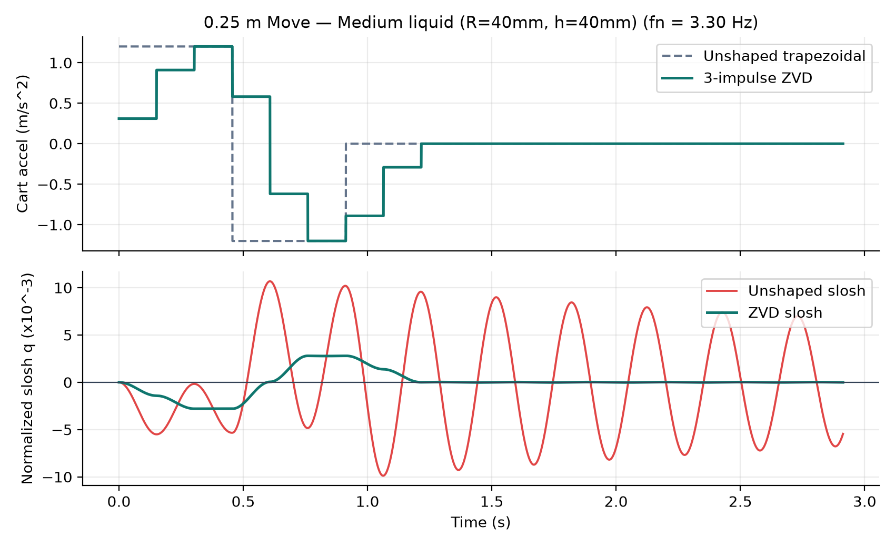

# Quell

**Acoustic-Tap Payload Perception and Edge-AI ZVD Input Shaping for Spill-Free Humanoid Manipulation**

Quell is a non-invasive wrist-level sensing and motion-shaping concept for robotic manipulators handling containers with unknown or visually obstructed contents. In kitchens, hospitals, labs, and warehouses, cameras often cannot see inside opaque cartons, sealed bottles, or open cups, while container mass alone does not capture how liquid inside will slosh when moved.

Rather than relying on cameras, intrusive probes, or pre-entered fill depths, Quell pairs a brief mechanical tap with on-device signal analysis and shaped motion control. While a grasped vessel is held stationary so actuator vibration does not pollute the measurement, a compact solenoid applies a repeatable 15 ms tap. The resulting acoustic ring-down and structural vibration response are captured locally to classify four coarse payload states:

- Empty
- Shallow liquid
- Medium / high liquid
- Solid or granular fill

Based on the inferred payload state and its calibrated slosh dynamics, the microcontroller generates a three-impulse Zero-Vibration-Derivative (ZVD) velocity profile to suppress dominant liquid oscillation during transport. Using ZVD's frequency-insensitivity margin around its design point allows coarse payload classification to drive practical wave suppression without requiring exact fluid-depth measurements.

## Hardware & Software Stack

- **Controller & Sensor Platform:** `STEVAL-STWINBX1` (`STM32U585AI` MCU, `ISM330DHCX` IMU with Machine Learning Core tap trigger, `IMP23ABSU` analog MEMS microphone up to 80 kHz, and `IIS3DWB` wideband accelerometer up to 6 kHz)
- **Acquisition & Edge AI:** `FP-SNS-DATALOG2` for synchronized logging, `ST AIoT Craft` (`FP-SNS-STAIOTCFT`), and `STM32Cube.AI` for quantized INT8 model deployment
- **Motion Stage:** Desktop linear-rail transport setup with an external motor driver and solenoid tapper, operating 100% offline with zero cloud or external SBC dependence

## Pre-Hardware Simulation Baseline

Before benchtop bring-up, we modeled the fundamental antisymmetric slosh mode in a rigid cylindrical vessel (`R = 40 mm`) across shallow (`15 mm`), medium (`40 mm`), and high (`70 mm`) fills for a stroke-matched `0.25 m` linear move. Across a `±14%` slosh-frequency mismatch window, three-impulse ZVD shaping cuts post-move residual oscillation by `> 95%` and shows why medium and high liquid fills can share one coarse class while shallow fills need a separate bucket.

Full simulation code, sensitivity sweeps, fill-depth curves, and CSV tables are documented in [`simulation/README.md`](simulation/README.md).

## Target Benchmarks

- **Classification:** >= 90% balanced accuracy across four rigid cylindrical container states within < 250 ms from tap onset
- **Slosh Suppression:** >= 70% reduction in peak free-surface displacement (and lower spilled mass) compared to unshaped motion, evaluated across ±14% slosh-frequency uncertainty
- **Compute Power:** < 200 mW average sensing, inference, and trajectory-shaping power (excluding solenoid and motor drive)

## Repository Structure

- [`docs/`](docs/) — System architecture notes and slosh/ZVD control derivations
- [`hardware/`](hardware/) — Desktop linear-rail rig, 15 ms solenoid tapper, and wiring notes
- [`simulation/`](simulation/) — Pre-hardware cylindrical slosh and 3-impulse ZVD scripts, CSV sweeps, and plots
