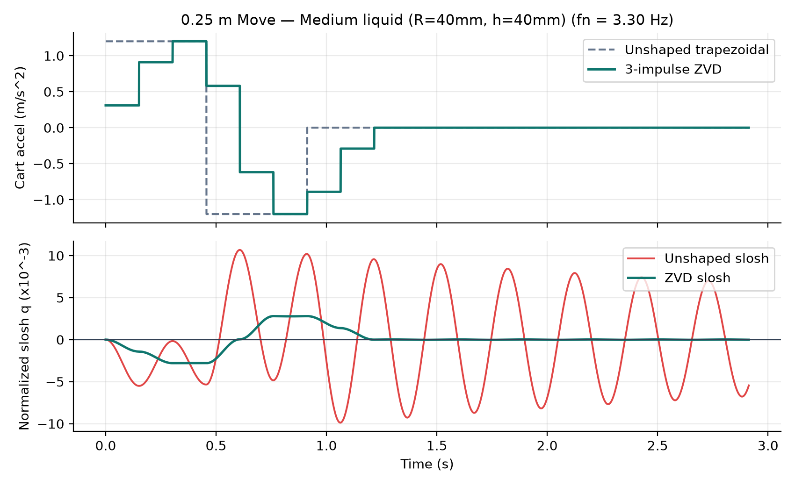
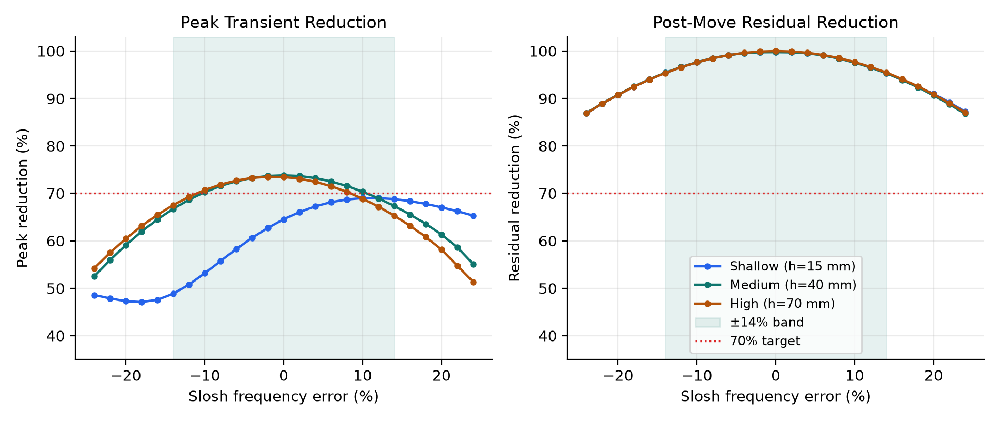
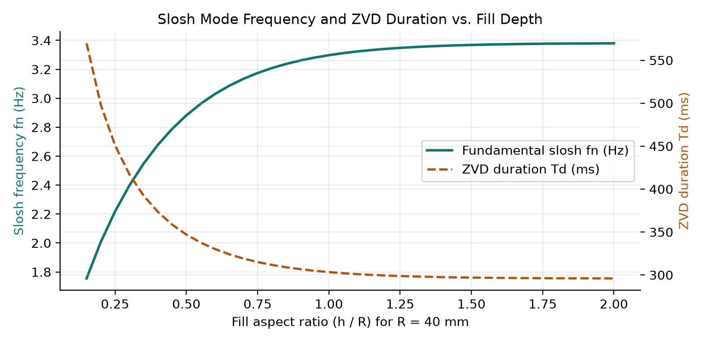

# Slosh and ZVD Simulation

This folder holds the pre-hardware physics checks we ran before building the linear-rail rig and logging sensor data on the `STEVAL-STWINBX1`. The goal is straightforward: sanity-check cylindrical slosh frequencies, verify three-impulse Zero-Vibration-Derivative (ZVD) pulse timing, and see how well the shaper holds up when the real slosh frequency drifts by ±14% from the assumed model.

## What Is Modeled

- **Container:** Upright rigid cylinder with inner radius `R = 40 mm` tested across three liquid fill heights: `15 mm` (shallow), `40 mm` (medium), and `70 mm` (high).
- **Slosh dynamics:** Lowest antisymmetric cylindrical slosh mode modeled as a lightly damped second-order oscillator (`zeta = 0.010` to `0.012`), integrated with a `0.5 ms` time step.
- **Motion command:** A `0.25 m` point-to-point trapezoidal move (`a_max = 1.20 m/s^2`, `v_max = 0.60 m/s`) compared directly against the same move convolved with a 3-impulse ZVD shaper.
- **Limitations:** This is a linear single-mode check. Higher slosh modes, wall flexibility, and real spilled liquid mass are out of scope here and will be measured on the benchtop rig.

## Key Numbers (`R = 40 mm`, `0.25 m` Move)

| Fill Case | Payload Bucket | Nominal `fn` (Hz) | ZVD `Td` (ms) | Peak Reduction (0% / ±14% band) | Residual Reduction (0% / ±14% band) |
| --- | --- | :---: | :---: | :---: | :---: |
| Shallow (`h = 15 mm`) | `shallow_liquid` | 2.616 | 382.3 | 64.6% / 48.8%–69.0% | 99.8% / 95.3%–99.8% |
| Medium (`h = 40 mm`) | `medium_high_liquid` | 3.298 | 303.3 | 73.8% / 66.8%–73.8% | 99.8% / 95.3%–99.8% |
| High (`h = 70 mm`) | `medium_high_liquid` | 3.377 | 296.2 | 73.5% / 65.3%–73.5% | 100.0% / 95.4%–100.0% |

Raw tables generated by the script:
- [`results/zvd_sweep_results.csv`](results/zvd_sweep_results.csv) — Unshaped vs. ZVD metrics swept from `-24%` to `+24%` frequency error in `2%` steps
- [`results/vessel_modes_table.csv`](results/vessel_modes_table.csv) — Fundamental slosh frequency `fn`, shaper duration `Td`, and impulse weights across `h/R = 0.15` to `2.00`

## Plots and Takeaways

### 1. Time-Domain Comparison (`h = 40 mm`)


With the unshaped trapezoidal move, the liquid keeps ringing after the carriage stops around `0.9 s`. Convolving the same move with three ZVD impulses spreads the acceleration steps over one slosh period (`303.3 ms`), cutting peak wave amplitude during transit and bringing post-move oscillation down close to zero once the cart settles.

### 2. Sensitivity Across ±14% Frequency Mismatch


Post-move residual slosh reduction stays above `95.3%` across the entire `±14%` band for all three fill depths (and above `86%` even out at `±24%`). Peak transient reduction during the move sits around `65%–74%` for medium/high liquid and `49%–69%` for shallow liquid, which is why we will track both peak free-surface displacement and actual spilled mass on hardware.

### 3. Why Coarse Fill Buckets Work (`h / R` Sweep)


For `R = 40 mm`, the slosh frequency rises steeply at shallow fills—from `1.755 Hz` (`Td = 569.8 ms`) at `h/R = 0.15` to `3.298 Hz` (`Td = 303.3 ms`) at `h/R = 1.00`—and then flattens out near `3.380 Hz` (`Td = 295.9 ms`) by `h/R = 2.00`. Because medium and high fills sit within a narrow frequency window, grouping them into one `medium_high_liquid` bucket and separating `shallow_liquid` is enough for ZVD to stay inside its tolerance band without measuring exact liquid height.

## Running Locally

```bash
pip install matplotlib
python simulation/slosh_zvd_sim.py
